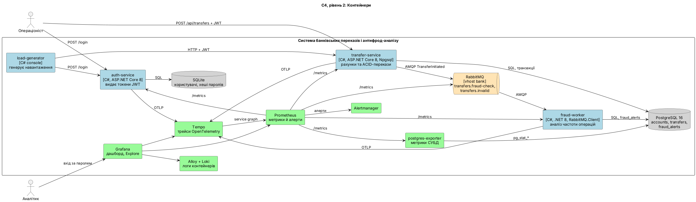
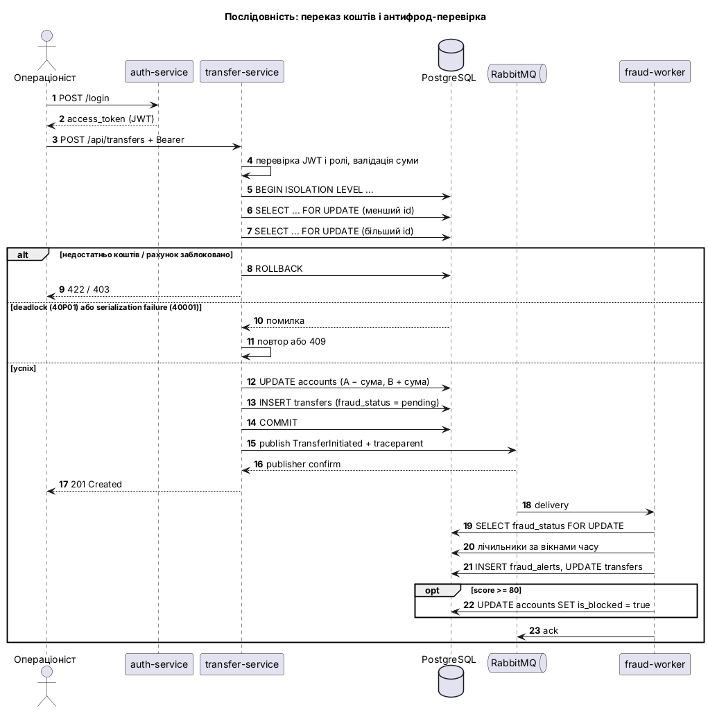
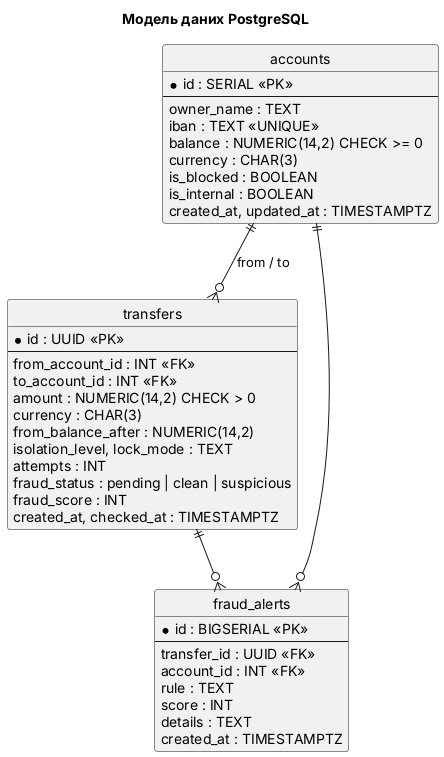

# 2. Архітектура

## Діаграми

Файли лежать у теці `docs/diagrams` (джерела `.puml`, зображення `.png`, IDEF0 у `.svg`).

| Діаграма | Файл | Що показує |
|---|---|---|
| C4, контекст | `c4-1-context` | систему та її користувачів |
| C4, контейнери | `c4-2-container` | сервіси, технології та зв'язки |
| C4, компоненти | `c4-3-component` | будову transfer-service і fraud-worker |
| Послідовність | `sequence-transfer` | кроки переказу та перевірки |
| Модель даних | `er-model` | таблиці PostgreSQL |
| IDEF0 A-0 | `idef0-A-0.svg` | систему як одну функцію |
| IDEF0 A-1 | `idef0-A-1.svg` | п'ять підфункцій і потоки між ними |
| IDEF0 A-2 | `idef0-A-2.svg` | деталізацію функції A2 «Виконати ACID-транзакцію» |

Позначення IDEF0: зліва вхід, справа вихід, зверху управління, знизу механізм. Рівень Code у C4 не робимо: у лекції 10 зазначено, що на практиці він зазвичай не потрібен.





## Як проходить переказ

1. Користувач входить через `POST /login` в auth-service і отримує токен JWT із роллю.
2. Клієнт надсилає `POST /api/transfers` у transfer-service.
3. transfer-service перевіряє токен і роль, перевіряє суму, починає трейс.
4. Відкривається транзакція з вибраним рівнем ізоляції. Обидва рахунки блокуються `SELECT ... FOR UPDATE` у порядку зростання id.
5. Перевіряються статус рахунків, валюта і баланс. Якщо умова не виконана, транзакція відкочується, клієнт отримує 4xx.
6. Баланси змінюються, переказ записується зі статусом `pending`, транзакція фіксується.
7. Подія `TransferInitiated` разом із контекстом трейса (`traceparent`) надсилається в exchange `bank` з ключем `transfer.initiated`; брокер підтверджує отримання.
8. RabbitMQ направляє подію в чергу `transfers.fraud-check`.
9. fraud-worker продовжує той самий трейс, блокує запис переказу, рахує статистику за вікнами часу і нараховує бал ризику.
10. Результат записується в `transfers` і `fraud_alerts`; за балу ≥ 80 рахунок блокується. Лише потім воркер надсилає ack.
11. Prometheus кожні 5 секунд забирає метрики сервісів, RabbitMQ, `postgres-exporter`, Loki, Tempo і Alloy.
12. Alloy збирає логи контейнерів у Loki, трейси надходять у Tempo, Tempo будує граф сервісів у Prometheus.
13. Grafana показує метрики, логи й трейси, Alertmanager отримує алерти.

## Формат події

```json
{
  "event_type": "TransferInitiated",
  "transfer_id": "c9f659ab-24c3-4039-bd77-a8d6755791b8",
  "from_account_id": 12,
  "to_account_id": 40,
  "amount": 621.28,
  "currency": "UAH",
  "from_balance_after": 52623.15,
  "initiated_by": "operator",
  "created_at": "2026-11-20T17:05:12.345678Z"
}
```

Заголовки AMQP: `message_id` = `transfer_id`, `type` = `TransferInitiated`, `traceparent` (W3C Trace Context), `delivery_mode` = persistent.

## Модель даних



| Таблиця | Призначення | Обмеження цілісності |
|---|---|---|
| `accounts` | рахунки | `balance >= 0`, унікальний IBAN, валюта з переліку |
| `transfers` | перекази | `amount > 0`, `from <> to`, зовнішні ключі, статус антифроду з переліку |
| `fraud_alerts` | спрацьовані правила | зовнішні ключі на переказ і рахунок |

Початкові дані: 6 внутрішніх розрахункових рахунків по 1 000 000 грн, 40 клієнтських рахунків у гривні з випадковим балансом, 4 рахунки в доларах.

## Права доступу до бази

| Роль PostgreSQL | Права |
|---|---|
| `bank_admin` | власник бази, лише для адміністрування |
| `transfer_service` | `accounts`: SELECT, INSERT, UPDATE; `transfers`: SELECT, INSERT; `fraud_alerts`: SELECT |
| `fraud_worker` | `accounts`: SELECT, UPDATE лише стовпця `is_blocked`; `transfers`: SELECT, UPDATE лише `fraud_status`, `fraud_score`, `checked_at`; `fraud_alerts`: SELECT, INSERT |
| `monitoring` | роль `pg_monitor` для `postgres-exporter` |

fraud-worker фізично не може змінити баланс, навіть якщо в його коді буде помилка.

## RabbitMQ

| Об'єкт | Значення |
|---|---|
| Virtual host | `bank` (стандартний `/` не використовується, `guest` не створюється) |
| Exchange `bank` | topic, durable |
| Exchange `bank.dead` | direct, для зіпсованих повідомлень |
| Черга `transfers.fraud-check` | durable, dead-letter у `bank.dead` з ключем `transfers.invalid` |
| Черга `transfers.invalid` | durable, для аналізу зіпсованих подій |
| `transfer_service` | може лише публікувати в `bank` |
| `fraud_worker` | може лише читати `transfers.fraud-check` |
| `bank` | адміністратор для веб-панелі |

## Рішення і причини

| Рішення | Причина |
|---|---|
| Транзакція з `SELECT ... FOR UPDATE` | баланс перевіряється і змінюється атомарно, без втрачених оновлень |
| Блокування рахунків у порядку зростання id | зустрічні перекази A→B і B→A не створюють deadlock |
| Рівень ізоляції та режим блокування через заголовок | можна порівняти режими під час захисту без перезапуску |
| Обмеження `CHECK (balance >= 0)` у базі | друга лінія захисту, якщо код помилиться |
| Розпізнавання SQLSTATE 40P01 і 40001 | deadlock і конфлікт серіалізації не є «внутрішньою помилкою», клієнт отримує 409 і може повторити |
| Подія після COMMIT | воркер ніколи не бачить переказ, якого немає в базі |
| Publisher confirms | transfer-service знає, що брокер прийняв подію |
| Sweeper у fraud-worker | переказ без події (брокер був недоступний) все одно перевіряється; заміна повного патерну Outbox |
| Ідемпотентність через `fraud_status = 'pending'` і `FOR UPDATE` | повторна доставка не створює дублікатів алертів |
| Ручний ack після запису в базу | подія не губиться при збої воркера |
| Окремий воркер для антифроду | переказ не чекає аналізу, збій аналізу не зупиняє перекази |
| Вікна часу рахуються від `created_at` переказу | результат не залежить від затримки в черзі |
| Внутрішні розрахункові рахунки не перевіряються | службові потоки між рахунками банку не дають хибних спрацювань |
| JWT із ролями | сервіси перевіряють токен без звернення до бази користувачів |
| PBKDF2-SHA256, 100 000 ітерацій, сіль | витік файлу SQLite не розкриває паролі |
| JSON-логи з `TraceId` | Loki розбирає рівень, а з логу можна перейти до трейсу |
| OpenTelemetry для ASP.NET Core і Npgsql | у трейсі видно кожну SQL-команду, зокрема час очікування блокування |
| Метрики tempo service graph | Grafana будує граф викликів між сервісами |
| Окремий обліковий запис на кожен сервіс | мінімальні права, видно, хто підключений |

## Принципи мікросервісної архітектури (лекція 11)

| Принцип | Як реалізовано |
|---|---|
| Індивідуальна відповідальність | auth-service авторизує, transfer-service виконує перекази, fraud-worker аналізує |
| Децентралізація даних | SQLite належить auth-service; у PostgreSQL кожен сервіс має власну роль і лише потрібні права |
| Розумні сервіси, прості з'єднання | логіка в сервісах, брокер лише доставляє події |
| Незалежне розгортання | кожен сервіс має власний образ і Dockerfile |
| Ізоляція відмов | зупинка fraud-worker не зупиняє перекази; зупинка RabbitMQ не зупиняє перекази |

## Сервіси й адреси

| Сервіс | Адреса | Вхід |
|---|---|---|
| auth-service | http://localhost:8002/login | `operator` / `operator_pass`, `analyst` / `analyst_pass`, `admin` / `admin_pass_123` |
| transfer-service | http://localhost:8000/api | токен |
| fraud-worker (метрики) | http://localhost:8001/metrics | без пароля |
| PostgreSQL | localhost:5433 | `bank_admin` / `bank_admin_pass` |
| RabbitMQ | http://localhost:15672 | `bank` / `bank_rabbit_pass` |
| Prometheus | http://localhost:9090 | без пароля |
| Alertmanager | http://localhost:9093 | без пароля |
| Alloy | http://localhost:12345 | без пароля |
| Loki | http://localhost:3100 | через Grafana |
| Tempo | http://localhost:3200 | через Grafana |
| Grafana | http://localhost:3000 | `admin` / `bank_grafana` |

Паролі навчальні, усі порти прив'язані до `127.0.0.1`.
